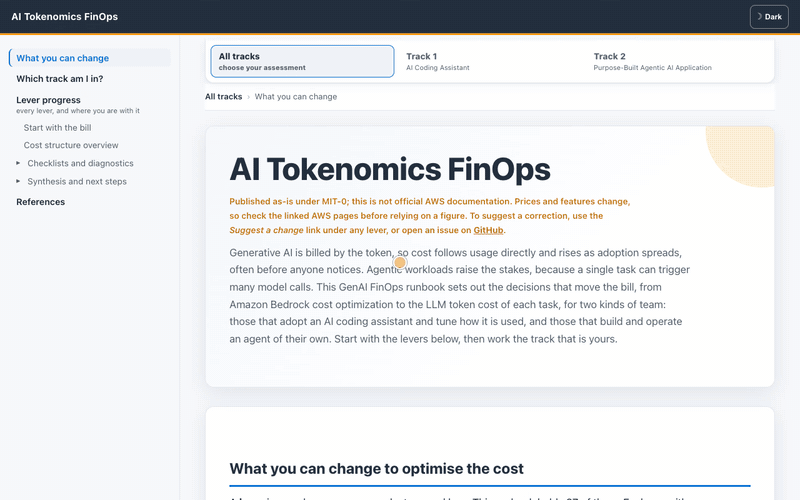
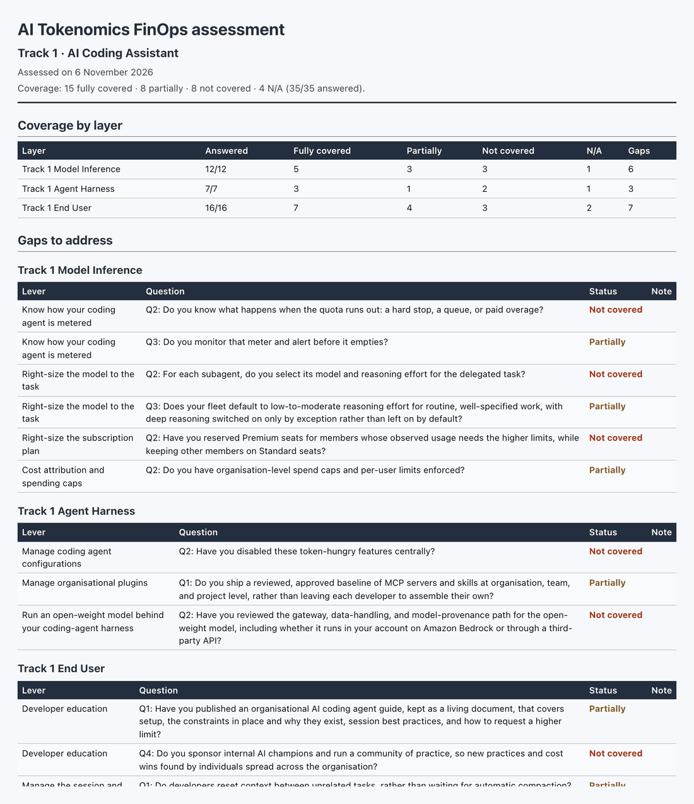

# AI Tokenomics FinOps

**Find the decisions that move your AI token bill.**

A browser-only self-assessment runbook for teams that use AI coding assistants or build agents on
Amazon Bedrock. 28 levers across 2 tracks. Answer the diagnostic questions, export a gap report.

**[Open the runbook](https://aws-samples.github.io/sample-aws-ai-tokenomics-finops/)** ·
[Contributing](CONTRIBUTING.md) ·
[Suggest a lever](https://github.com/aws-samples/sample-aws-ai-tokenomics-finops/issues/new?template=new-lever.yml)

> Sample guidance published as-is under MIT-0. Not official AWS documentation and not supported by AWS.
> Prices change: confirm figures against the linked AWS pages. Dollar figures are illustrative unless dated and cited.

## Who it's for

| Track | For teams that | Levers |
|---|---|---|
| 1. AI Coding Assistant | adopt an AI coding assistant and tune how it is used | 11 |
| 2. Purpose-Built Agentic AI Application | build and operate their own agent on Amazon Bedrock | 17 |

Each track groups its levers into three actor layers: Model Inference, Agent Harness, End User.

## How to use the runbook

1. Open the [live site](https://aws-samples.github.io/sample-aws-ai-tokenomics-finops/). No install, no clone.
   For offline use, download [`content/index.html`](content/index.html) and open it from disk.
2. Pick your track. "Which track am I in?" helps if you are unsure.
3. For each lever, answer the diagnostic questions: Fully covered, Partially, Not covered, N/A.
4. Open the detailed guidance only where you have a gap.
5. Export the gap report from the track dashboard as Markdown or PDF.

Run it alone, or as a quarterly session with engineering and finance.

## What you get

A dated gap report: coverage counts per layer, the gaps to address with links to the guidance, and every
answer with your notes. Download it as Markdown, copy it to the clipboard, or print it to PDF, for a whole
track or a single layer.

## Private by design

- Runs entirely in your browser. No backend, sign-in, analytics, or network calls of its own, enforced by
  a strict Content-Security-Policy.
- Answers and notes stay in your browser's `localStorage`.
- Reports are dated, not attributed.

## Contributing

Corrections and new evidence are welcome. Every lever on the site has a **Suggest a change** link that
opens a prefilled issue for that section. See [CONTRIBUTING.md](CONTRIBUTING.md) to build, verify, and open
a pull request.

## Security

See [CONTRIBUTING](CONTRIBUTING.md#security-issue-notifications) for more information.

## License

This sample is licensed under the MIT-0 License. See the [LICENSE](LICENSE) file.
